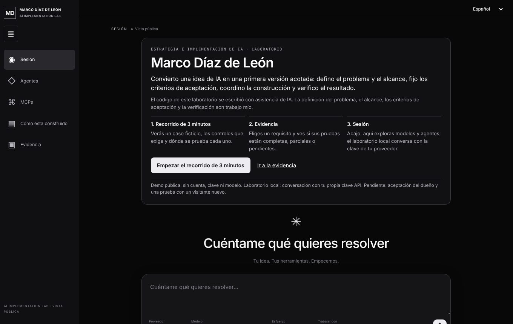

# AI Implementation Lab

**Marco Díaz de León · AI implementation strategy**

I turn an AI idea into a bounded first version. I define the problem and the scope, set the acceptance criteria, coordinate the build and verify the result. This repository is a small working lab that shows that method on a fictional case.

The code was written with AI assistance. The problem definition, scope, acceptance criteria and verification are my work.

**First action: [open the public demo](https://marcodiazleon.github.io/ai-implementation-lab/)** and press *Start the three-minute tour*. No account, key or model is needed.

> **Not published yet.** That URL serves main at the revision recorded under `deployment` in [project-status.json](docs/project-status.json). While that record says `NOT_DEPLOYED` for this branch, the URL does not include this delivery: no presentation, tour or evidence status. Until then, see them with the local lab (`python run.py serve`).



The screenshot comes from the public build of this revision, served locally.

## Three routes

- **30 seconds.** Read the presentation at the top of Session: who I am, what I contribute and what is still pending.
- **3 minutes.** Follow the tour in *How it is built*. Each step names what you do, the expected result and the control it demonstrates, and links to that control's evidence.
- **Technical review.** Start at the [documentation index](docs/INDEX.md): specification, architecture, decisions, tests, evidence and one requirement traced from need to evidence.

## What the lab demonstrates

- **Controls before effects.** In a fictional refund case, the lab generates a simulated proposal that cannot execute until a person approves it. A simulated failure creates no receipt, a retry creates exactly one, and repeating returns the same receipt.
- **Traceability.** Every requirement links to tasks, acceptance cases, tests and recorded evidence. A requirement is PASS only when all its applicable cases passed; otherwise it shows as partial, pending, blocked or failed.
- **Honest records.** Automated verification, independent review, owner acceptance, integration and deployment are recorded separately, and none of them is implied by another.
- **Bounded AI connections.** The local lab can converse with OpenAI or Anthropic using your own key and explicit consent. Agents are text-only, and the MCP adapter is read-only.

## Public demo, local lab and pending

| | Public demo | Local lab |
|---|---|---|
| Needs | A browser | Python 3.11+ and Git; your own API key only for conversations |
| Session | Presentation, model catalog and agent drafts; no model replies | Conversation with your own provider key |
| Refund case | Described in the tour; not run in the interface by the owner's decision (U13) | `python run.py tour` and the test suite |
| Evidence | Committed run, cases and project records | The same, plus `python scripts/verify.py` |

Pending: owner acceptance, a test with a new visitor, a recorded live provider call, an owner decision on a visible route for the refund case, and the reconciliation of open pull requests #4 to #6. The full table is in [capabilities.md](docs/capabilities.md).

## Run locally

```sh
git clone https://github.com/marcodiazleon/ai-implementation-lab.git
cd ai-implementation-lab
python scripts/check_environment.py
python run.py tour
python scripts/verify.py
python run.py serve
```

Open http://127.0.0.1:8765. `python scripts/verify.py` rewrites the versioned evidence files; review them with `git diff` and restore them if you do not mean to commit a new run. Node is needed only for the browser parity tests.

## Limits

Fictional data and simulated effects only. There are no real customers, refunds, integrations or commercial results. The reviewer role has no real authentication and state lives in memory. [Security boundaries](SECURITY.md).

## Reuse and contact

The repository is public for inspection; no open-source license is granted in this version. To discuss an implementation, contact Marco through [his GitHub profile](https://github.com/marcodiazleon).

---

## En español

Convierto una idea de IA en una primera versión acotada: defino el problema y el alcance, fijo los criterios de aceptación, coordino la construcción y verifico el resultado. El código se escribió con asistencia de IA; las decisiones, el alcance y la verificación son trabajo mío.

Primera acción: abre la demo pública y pulsa *Empezar el recorrido de 3 minutos*. Aviso: mientras project-status.json registre esta rama como `NOT_DEPLOYED`, la URL pública sirve otra revisión de main sin esta entrega; usa el laboratorio local. En 30 segundos lees la presentación de Sesión; en 3 minutos sigues el recorrido de *Cómo está construido*; para una revisión técnica, empieza en el índice de documentación enlazado arriba. La [guía en español](docs/START_HERE_ES.md) explica la instalación local.
