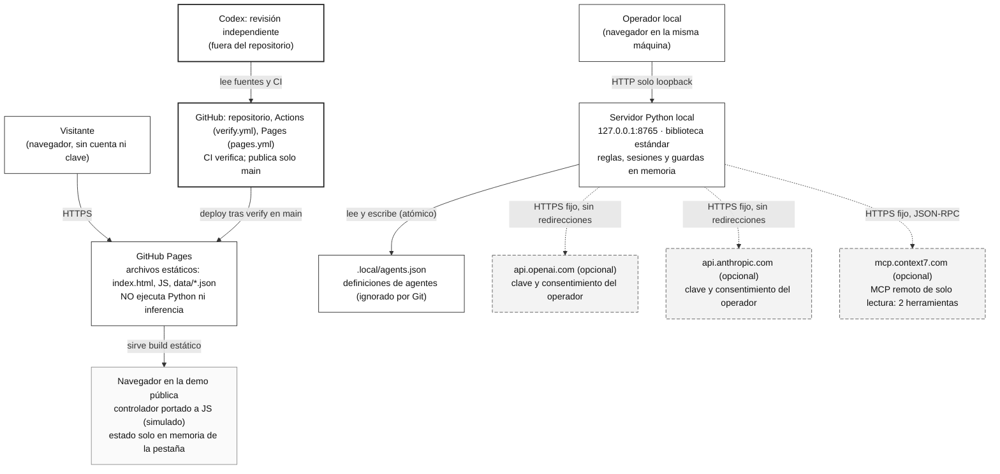
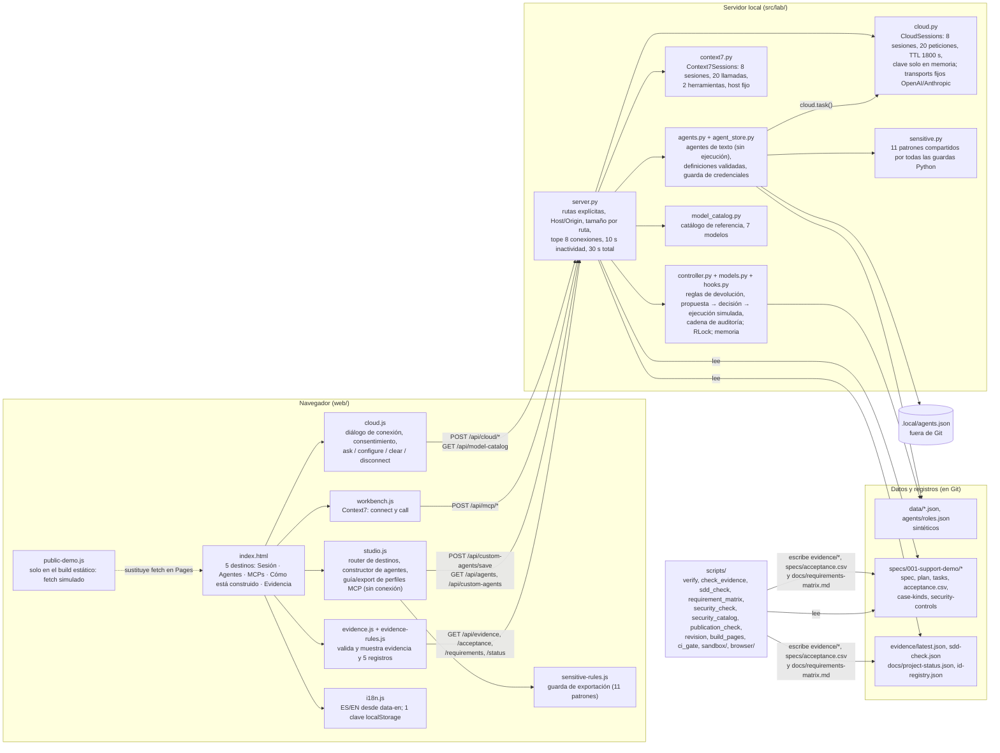

# 2 Arquitectura: contexto, componentes y fronteras

[Índice del libro](README.md) · Código descrito: `a16a4e67b4257c2cb13054efd3ffa20acc2dd3be` (PR #9). Cada caja y cada flecha de este capítulo corresponde a un archivo y una línea de esa revisión; lo que no está implementado se marca como **opcional**, **simulado** o **futuro** y no aparece como flecha normal. Los diagramas están en Mermaid (editable aquí mismo) y cada uno va seguido de su equivalente en texto, para lectores de pantalla y para quien no vea el render.

## 2.1 Diagrama de contexto

Leyenda: borde continuo = implementado en esta revisión; `opcional` = necesita una clave del operador y su consentimiento; `simulado` = datos sintéticos, sin efecto real; `futuro` = no existe en el código. Los colores solo refuerzan; el texto de cada nodo lleva la etiqueta.

**Equivalente en texto.** Hay dos rutas y nunca se cruzan en tiempo de ejecución:

| Ruta | Quién | Qué corre | Qué no puede hacer | Fuente |
|---|---|---|---|---|
| Pública (estática) | Visitante | GitHub Pages sirve `_site/`: `index.html`, los mismos `web/*.js` más `public-demo.js`, y copias de `data/*.json`, `evidence/latest.json`, `acceptance.csv`, `status.json` | No ejecuta Python; `public-demo.js` sustituye `fetch` para `/api/*`: cinco GET leen archivos estáticos, ocho rutas (cuatro GET y cuatro POST) se responden en memoria del navegador con un port del controlador, y todo lo demás recibe `403 PUBLIC_DEMO_DISABLED` (cloud, MCP, `agents/run`) | `scripts/build_pages.py:34-61`, `web/public-demo.js:131-163` |
| Local | Operador | `python run.py serve` → `src/lab/server.py:make_server` en `127.0.0.1` (`server.py:314`) con un `Lab()`, un `CloudSessions()`, un `Context7Sessions()` y un `AgentStore` | No escucha fuera de loopback; rechaza Host/Origin ajenos (`403 HOST_OR_ORIGIN_BLOCKED`, `server.py:178-181`); no sigue redirecciones ni URL del operador | `src/lab/server.py:149-325` |
| Proveedores (opcionales) | Solo el servidor local | HTTPS a `api.openai.com` o `api.anthropic.com` con la clave que el operador pega y su consentimiento explícito; a `mcp.context7.com` para dos herramientas de lectura | Ningún otro host (`scripts/security_check.py` lo comprueba); ninguna llamada sin `consent: true`; el desarrollador no ejecuta inferencia pagada | `src/lab/cloud.py:11,22,93`, `src/lab/context7.py:22-24`, `cloud.py:140-141` |
| GitHub | CI y publicación | `verify.yml` en cada push y PR (Linux 3.11/3.13, Windows 3.13, dos gates); `pages.yml` reutiliza verify y despliega **solo** desde `main` (push o `workflow_dispatch` en main) | CI nunca autoriza publicación ni equivale a aceptación (R56e) | `.github/workflows/verify.yml`, `pages.yml:5-7,16-18,36-38` |
| Revisión independiente | Codex | Lee fuentes, CI y registros; sus informes quedan fuera del repositorio | No ejecuta el candidato; su reproducción queda registrada como pendiente | [docs/notebook.md](../notebook.md), entradas U21 y U22 |

Lo que **no** es una flecha: un rol o prompt de agente no concede permisos (constitución, punto 7); configurar un perfil MCP en la pestaña *MCPs* no conecta nada (solo guarda y exporta JSON, `web/studio.js:34-50`); el servidor MCP por stdio (`src/lab/mcp_server.py`) solo arranca con `python run.py mcp` y no lo usa el servidor HTTP.

## 2.2 Diagrama de componentes

**Equivalente en texto: componentes, estado y fronteras de confianza.**

| Componente | Archivo | Responsabilidad | Estado | Frontera que cruza |
|---|---|---|---|---|
| Cinco destinos | `web/index.html:22` (`nav#mainNav`), `web/studio.js:4,11` | `#session`→`view-demo` (Sesión, conversación), `#agents`, `#mcp`, `#method` (recorrido), `#evidence`; `#connection` abre el diálogo, no es destino; cualquier hash desconocido cae en Sesión | Hash de la URL | Ninguna |
| Sesión (vista) | `web/index.html:24-55`, `web/cloud.js` | Presentación, orientación de 3 pasos, compositor con proveedor/modelo/esfuerzo/agente, diálogo de conexión con casilla de consentimiento `required` (`index.html:67`) | En memoria de JS: `session` (token y metadatos, `cloud.js:65`), mensajes solo como nodos DOM; la clave se borra del campo antes de enviar (`cloud.js:64`) y nunca se guarda | Navegador → servidor local |
| Sesión de proveedor | `src/lab/cloud.py:164-165` | Fila `sessions[token]` con clave, proveedor, transport, modelo, límite, esfuerzo, historial (16 mensajes, 24 000 caracteres), contador (20), `busy`, `touched` | Memoria del proceso; TTL 1800 s; máximo 8; `disconnect` y `_prune` borran clave e historial (`cloud.py:126-131,244-252`) | Servidor local → proveedor |
| Transports | `cloud.py:22,93` | `OpenAITransport` (`POST /v1/responses`, `store:false`), `AnthropicTransport` (`POST /v1/messages`); `check` = `GET /v1/models/{model}`; respuesta ≤ 1 MiB; sin redirecciones; errores 401/403/404/429 mapeados a códigos fijos devueltos como 502 | Sin estado | Proveedor (solo con clave y consentimiento) |
| Context7 | `src/lab/context7.py:22-24,75-143`, `web/workbench.js` | `connect` (initialize, initialized, tools/list que debe incluir `resolve-library-id` y `query-docs`), `call` con consentimiento por llamada, argumentos en lista blanca, texto ≤ 12 000 | Memoria; TTL 1800 s; 8 sesiones; 20 llamadas | Servidor local → `mcp.context7.com` |
| Perfiles MCP (guía) | `web/studio.js:34-50` | Valida con `LabSensitive` y una expresión de palabras de credencial, guarda hasta 20 perfiles y exporta `mcp-config.json` | `localStorage` `lab.mcp-profiles` | Ninguna: **configurar no es conectar** |
| Agentes | `src/lab/agents.py`, `agents/roles.json`, `src/lab/agent_store.py` | Roles de texto con contrato `can_execute_code: False` (`agents.py:16-19`); `run_agent` en modo local (plantillas) o con una llamada `cloud.task`; definiciones personalizadas validadas en el servidor (claves exactas, longitudes, id `custom-[0-9a-f]{32}`, patrones compartidos); en Pages solo un array en memoria con una guarda de dos formatos | `.local/agents.json`, escritura atómica, ≤ 50 filas, ≤ 400 000 bytes | Rol/prompt → instrucciones de conversación; **nunca** permisos |
| Guardas | `src/lab/sensitive.py`, `web/sensitive-rules.js`, `web/public-demo.js:119` | 11 patrones con nombre; `find_secrets_in` recorre cada cadena cruda y la serialización completa. Cobertura por ruta: almacén local (`agent_store.py:39`) y ejecutor con los 11 patrones; exportación de agentes y perfiles MCP en el navegador con `LabSensitive` (los mismos 11); **guardado de agentes en la demo pública** (`public-demo.js:113-129`) con solo dos formatos (`sk-…` y bloque de clave privada): brecha de cobertura registrada como pendiente técnico (C326, SC-02), no corregida en esta entrega documental | Sin estado | Fuente ↔ Git; navegador ↔ descarga |
| Controlador | `src/lab/controller.py`, `models.py`, `hooks.py` | `request` (intents `lookup`/`refund`), elegibilidad, `Proposal` con digest, `decide` solo por `human_reviewer`, `execute` con recibo `SIM-…` y `real_effect: False`; `fail_connector` falla antes de escribir | Memoria con `RLock`; un `Lab()` por proceso compartido por todos los clientes | Ninguna real: todo es sintético |
| Evidencia | `web/evidence.js`, `evidence-rules.js`, `scripts/revision.py` | Cuatro GET, validación de forma, insignias (FAIL > BLOQUEADO > PASS > PARCIAL > PENDIENTE; NO_APLICA fuera), cinco filas de registro, `build_states` calculados con Git | Sin almacenamiento | Navegador → archivos publicados o servidor |
| Scripts | `scripts/*.py`, `scripts/sandbox/`, `scripts/browser/` | Verificación, huellas, SDD, matriz, seguridad, catálogo, guarda, build, gate; corredor aislado y comprobaciones de navegador (fuera de CI) | Escriben `evidence/*`, `acceptance.csv`, `requirements-matrix.md` | Desarrollo → registros |

**Fronteras de confianza, de la más abierta a la más cerrada** (detalle y mitigaciones en [docs/threat-model.md](../threat-model.md)):

1. Navegador público ↔ Pages: sin servidor, sin claves, sin datos de visitantes; CSP como `meta` (sin `frame-ancestors`, que un `meta` no puede fijar; `build_pages.py:16-17`).
2. Navegador local ↔ servidor local: mismo origen (Host y Origin), no autenticación frente a otros procesos de la máquina (R55e).
3. Servidor local ↔ proveedores y Context7: hosts fijos, consentimiento, límites de sesión y de respuesta, sin reintentos automáticos.
4. Código ↔ Git/GitHub: guarda de publicación, acciones fijadas por SHA, permisos mínimos, CI reproducible.
5. Validación ↔ host del implementador: corredor aislado de tres etapas ([cap. 6](06-validacion.md#63-el-corredor-aislado)).

## 2.3 Qué vive dónde

| Dato | Dónde | Cuánto dura | Quién lo borra | Fuente |
|---|---|---|---|---|
| Clave de proveedor | Memoria del servidor local, fila de sesión | Hasta `disconnect`, expiración (1800 s de inactividad) o parada del servidor | `cloud.py:126-131,244-252`; el borrado absoluto de memoria de proceso no se garantiza (R54e) | `src/lab/cloud.py` |
| Historial de conversación | Misma fila de sesión; 16 mensajes / 24 000 caracteres | Igual; `clear` y cambio de agente lo vacían | `cloud.py:188-203,233-242` | |
| Token de sesión | Variable JS `session`; se devuelve en `connect` y se acepta en los campos de sesión; nunca en errores, estado ni stderr (R54c) | Pestaña | Recarga, `disconnect` | `web/cloud.js:65` |
| Definiciones de agentes | `.local/agents.json` (ignorado por Git); en Pages, solo un array en memoria de la pestaña | Disco local | El operador | `src/lab/agent_store.py`, `web/public-demo.js:24,113` |
| Preferencias de interfaz | `localStorage`: `ai-implementation-lab.language`, `lab.sidebar`, `lab.mcp-profiles` | Navegador | El visitante | `web/i18n.js:183-185`, `web/studio.js:15,42` |
| Propuestas, recibos, auditoría | Memoria del proceso (`Lab`) o de la pestaña (Pages) | Reinicio | Reinicio | `src/lab/controller.py:15-21` |
| Registros y evidencia | Git | Permanente, por revisión | Nadie reescribe historia (D34) | `evidence/`, `specs/`, `docs/project-status.json` |

Nada de esto se escribe en logs: `log_message` es nulo y `handle_error` imprime una línea fija sin mensaje (`server.py:144-146,163-164`).

## 2.4 Lo que la arquitectura no hace

- La demo pública no conversa con ningún modelo; el catálogo de modelos es un archivo estático de referencia (`model_catalog.py`, revisado 2026-10-03).
- El ejercicio de devoluciones ya no está en la interfaz (U13); `web/app.js` sigue en el repositorio y se sirve, pero `index.html` no lo carga (`tests/test_session_shell.py:31`). Se ejecuta con `python run.py tour`.
- `POST /api/agents/run` existe en el servidor pero ninguna vista lo llama; lo ejercen las pruebas (`tests/test_workbench_http.py`, `tests/test_u21.py`).
- Los mensajes de chat no pasan por el detector de credenciales (`cloud.py:172-210` no llama a `find_secrets`); las guardas cubren briefs de agentes, definiciones, exportaciones y el árbol de Git.
- Autenticación real, aislamiento de usuarios, cifrado en reposo, auditoría durable y firma son **futuro** (SC-17, nunca contado como aprobado).

## Summary in English

Two routes never meet at run time. The public route is GitHub Pages serving the static build: the same `web/*.js` plus `public-demo.js`, which replaces `fetch` so five GETs read committed JSON files, eight routes are answered in browser memory by a JS port of the controller, and everything else (cloud, MCP, agent runs) gets `403 PUBLIC_DEMO_DISABLED`; Pages executes no Python and no inference. The local route is `src/lab/server.py` on `127.0.0.1:8765` with explicit routes, Host/Origin checks, per-route body limits, a cap of 8 connections and 10 s / 30 s read limits; it holds the refund controller, provider sessions (key in memory only, 8 sessions, 20 requests, 1800 s idle), Context7 sessions, text-only agents and the shared credential detector. Optional calls go only to `api.openai.com`, `api.anthropic.com` and `mcp.context7.com`, with the operator's key and explicit consent. Configuring an MCP profile does not connect anything; a role or prompt grants no permission; the stdio MCP server is a separate `run.py mcp` process. The textual tables above are the accessible equivalent of the two diagrams and name the file and line of every claim.
