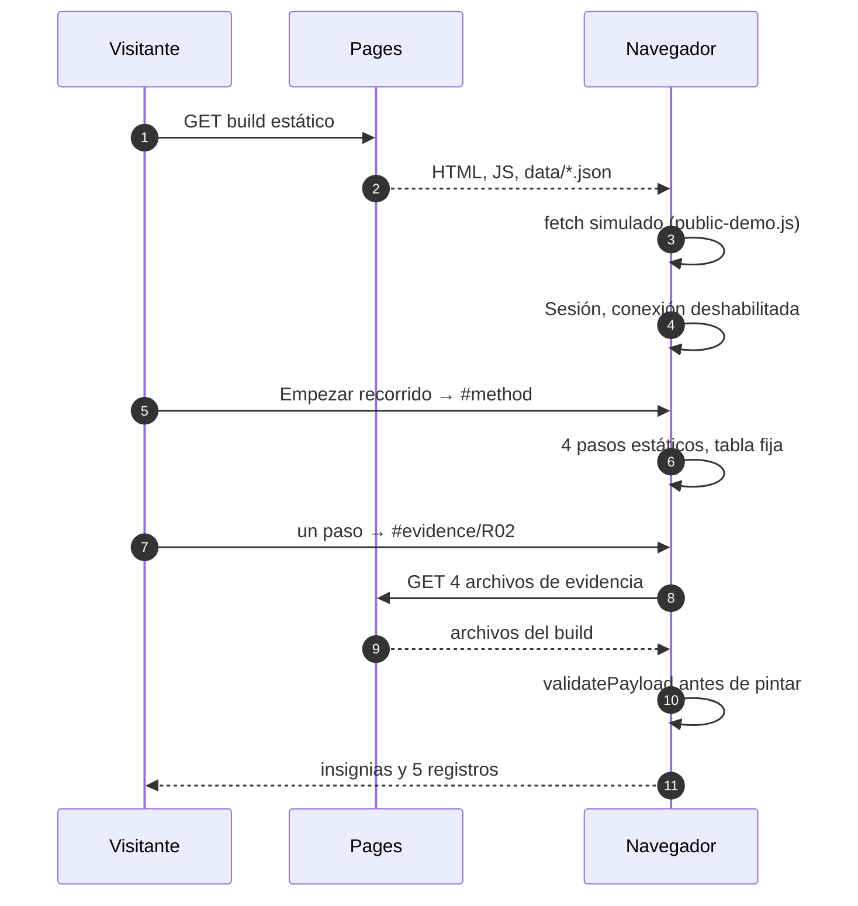
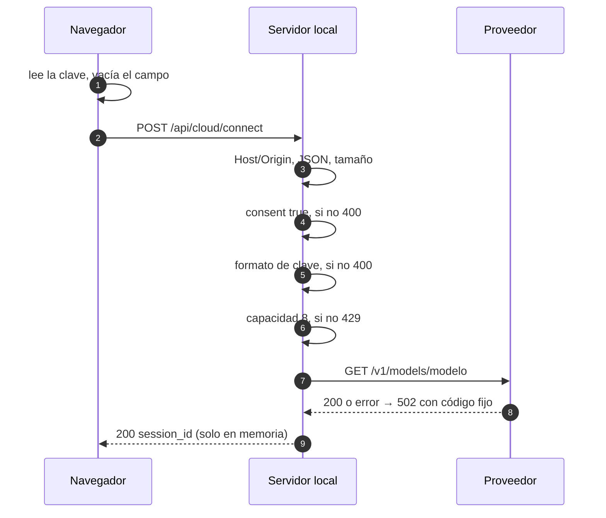
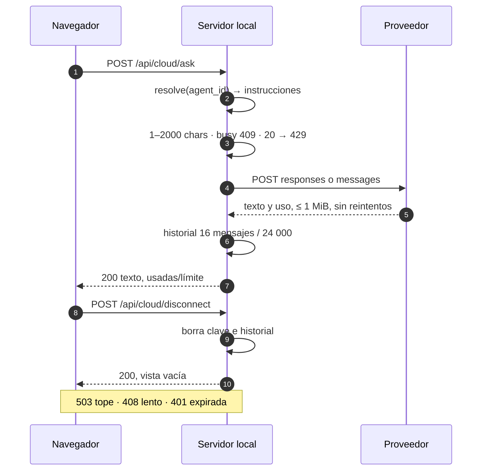
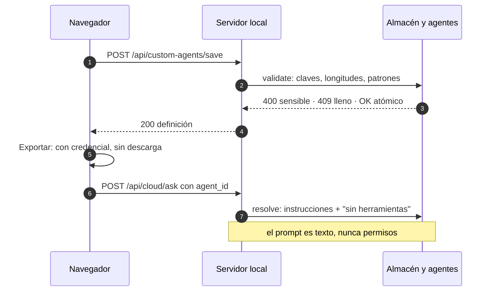
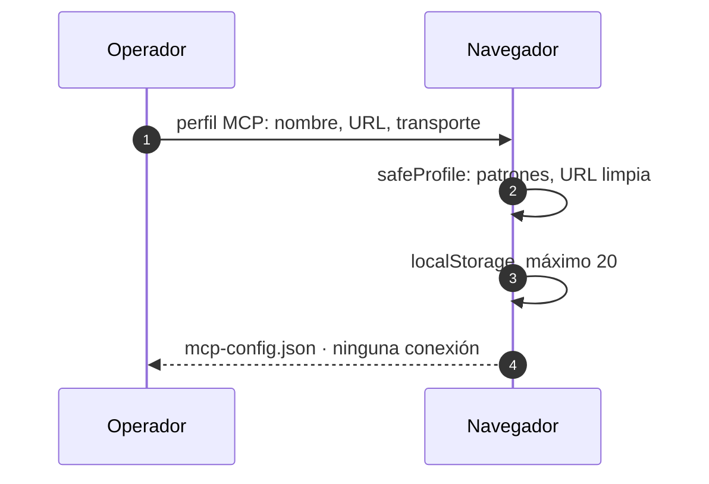
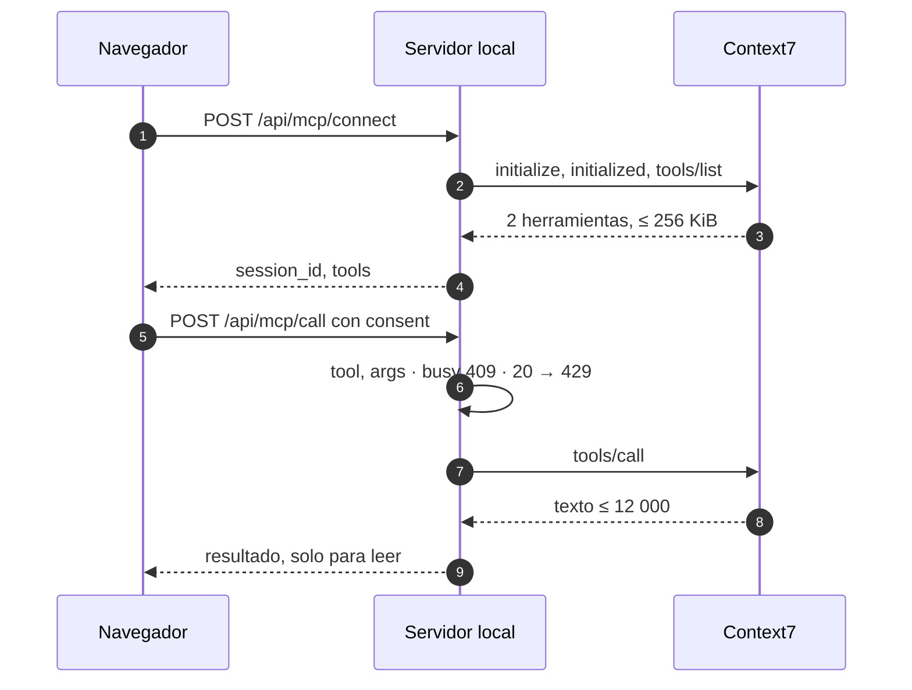

# 3 Recorrido del código y secuencias

[Índice del libro](README.md) · Código descrito: `a16a4e67b4257c2cb13054efd3ffa20acc2dd3be` (PR #9). Las secuencias dibujan comportamiento que existe en esa revisión; están trazadas para una pantalla de 390 px (fragmentos de tres participantes como máximo y mensajes cortos), y el archivo y la línea de cada paso están en el equivalente textual que sigue a cada una. Donde hay rechazo, error, límite o desconexión se dice qué código devuelve el servidor y qué ve la persona.

## 3.1 Mapa de carpetas en una pantalla

| Carpeta | Qué contiene | Entra en la huella de fuentes |
|---|---|---|
| `run.py`, `src/lab/cli.py` | Comandos `serve`, `demo`, `evaluate`, `mcp`, `tour`; `--port` (8765), `--lang` | Sí |
| `src/lab/` | `server.py` (HTTP), `controller.py`/`models.py`/`hooks.py` (devoluciones simuladas), `cloud.py` (proveedores), `context7.py` (MCP remoto), `agents.py`/`agent_store.py` (agentes de texto), `sensitive.py` (detector), `model_catalog.py`, `mcp_server.py` (stdio) | Sí |
| `web/` | `index.html` y los módulos de la [tabla de componentes](02-arquitectura.md#22-diagrama-de-componentes) | Sí |
| `data/`, `agents/roles.json` | Pedidos DEMO-101…105, política (100 DEMO, 14 días), 7 escenarios, 4 roles | Sí |
| `scripts/` | Verificación y gates; `sandbox/` y `browser/` | Sí |
| `tests/` | `unittest`, descubiertos por `scripts/verify.py` | Sí |
| `specs/001-support-demo/` | spec, plan, tasks, `acceptance.csv`, `case-kinds.json`, `security-controls.json` | No: huella de registros |
| `docs/project-status.json`, `docs/id-registry.json` | Registros de aceptación, revisión, integración, despliegue; IDs reservados | No: huella de registros |
| `evidence/` | `latest.json`, `sdd-check.json` escritos por `verify.py` | En ninguna huella (D38) |
| `docs/`, `reports/` | Explicación e informes; no se huellan, las pruebas los leen | No |

Las dos huellas (`source_id`, `record_id`) las calcula `scripts/check_evidence.py:29-32`; ningún archivo contiene su propia huella (D38).

## 3.2 Secuencia A: recorrido y vista Evidencia en la demo pública

Qué es el "recorrido": una página estática dentro del destino *Cómo está construido* (`web/index.html:76-115`), con cuatro pasos y una tabla de resultado escrita a mano. No ejecuta nada; `web/orientation.js:1-7` solo pliega la orientación en pantallas de 700 px o menos. El enlace *Empezar el recorrido de 3 minutos* es `href="#method"` (`index.html:37`).

**Equivalente en texto.** 1) Pages entrega el build; 2) `public-demo.js` marca la página como pública y redirige `/api/*` a archivos o a memoria; 3) Sesión aparece con la conexión deshabilitada; 4) el recorrido es contenido estático; 5) Evidencia lee cuatro archivos comprometidos en el build (`status.json` se calculó en CI al construir, `build_pages.py:44-46`), valida su forma antes de pintar nada y muestra cinco registros separados. En la demo pública **no hay** llamada a ningún servidor Python ni a ningún modelo.

Qué significa "mismo contenido que la revisión aceptada/publicada": `scripts/revision.py:97-112` compara el árbol de Git de la revisión registrada con el árbol de HEAD y exige que no haya archivos servidos modificados; "integrada" significa que HEAD es ancestro de `integration.main` (`revision.py:113-123`). Un candidato en rama nunca hereda el estado de main (D41, D43).

## 3.3 Secuencia B: pregunta local con conexión opcional y consentimiento

Fragmento B1, conectar:

**Equivalente en texto:** pasos 1–9 de la lista que sigue y la tabla de rechazos.

Fragmento B2, preguntar y desconectar:

**Equivalente en texto, con archivo y línea.** 1) El diálogo lee la clave y vacía el campo antes de enviar (`cloud.js:64`); 2) `POST /api/cloud/connect` con proveedor, clave, modelo, esfuerzo, límite y consentimiento; 3) el servidor comprueba Host/Origin, tipo JSON, tamaño ≤ 16384 y objeto (`server.py:260-274`); 4) `connect` exige `consent: true` (`cloud.py:140-141`); 5) formato de clave 20–300 caracteres `[A-Za-z0-9_-]` antes de cualquier red (`cloud.py:147-148`), modelo, límite 256–8192, esfuerzo; 6) capacidad 8 sesiones (`cloud.py:157-158`); 7) `GET /v1/models/{model}` al host fijo con la clave (`cloud.py:52-55`); 8) 401/403/404/429 del proveedor se devuelven como 502 con código fijo (`cloud.py:35-38`); 9) token `token_urlsafe(32)` devuelto y guardado solo en la variable `session` (`cloud.py:162-170`, `cloud.js:65`). Preguntar: 10) `POST /api/cloud/ask` con `session_id`, `message`, `agent_id` (`cloud.js:68-70`); 11) `agent_store.resolve` da instrucciones y `context_id` (`server.py:278-280`, `agent_store.py:63-73`); 12) mensaje 1–2000, `busy` → 409, 20 peticiones → 429, el contador sube antes de llamar (`cloud.py:176-186`); 13) `POST /v1/responses` con `store:false` o `POST /v1/messages`, con instrucciones del agente, hasta 16 mensajes y el nuevo (`cloud.py:57-66,99-115,194`); 14) respuesta ≤ 1 MiB, sin reintentos ni redirecciones (`cloud.py:29,34,39`); 15) historial recortado a 16 mensajes / 24 000 caracteres (`cloud.py:201-203`); 16) la vista muestra la respuesta y "usadas/límite · tokens" (`cloud.js:70`). Desconectar: 17) `POST /api/cloud/disconnect` (`cloud.js:46`); 18) la fila borra clave e historial (`cloud.py:244-252`); 19) la vista vacía mensajes y consentimiento.

**Casos de rechazo.**

| Situación | Dónde se corta | Código | Qué ve la persona |
|---|---|---|---|
| Sin consentimiento | Navegador: la casilla es `required` (`index.html:67`); servidor: `cloud.py:140-141` | `400 CONSENT_REQUIRED` | Mensaje mapeado más el código (`cloud.js:12-13,66`) |
| Clave mal formada | Antes de cualquier red (`cloud.py:147-148`) | `400 INVALID_KEY_FORMAT` | Igual |
| Clave rechazada por el proveedor | `transport.check` (`cloud.py:35-38,52-55`) | `502 API_KEY_REJECTED` | Igual; el cuerpo del proveedor nunca se copia |
| Novena sesión | `cloud.py:157-158` | `429 SESSION_CAPACITY` | Igual |
| Vigésimo primera pregunta | `cloud.py:183-184`; los intentos fallidos también cuentan (`cloud.py:186`) | `429 SESSION_REQUEST_LIMIT` | Igual |
| 1800 s sin actividad | `_prune` en la siguiente operación (`cloud.py:126-131`) | `401 SESSION_EXPIRED` | El navegador descarta `session` (`cloud.js:71`) |
| Novena conexión simultánea | `server.py:121-131`, antes de crear un hilo o leer un byte | `503 SERVER_BUSY` | Igual |
| Cliente lento o incompleto | `DeadlineReader` (`server.py:41-91`): 10 s sin bytes o 30 s totales | `408 REQUEST_TIMEOUT` | Igual |
| Host u Origin ajenos | `server.py:178-181` | `403 HOST_OR_ORIGIN_BLOCKED` | Igual |
| Excepción inesperada | `server.py:189-191` | `500 INTERNAL_ERROR` sin mensaje; stderr imprime una línea fija (`server.py:144-146`) | Igual |

Qué sale hacia el proveedor y nada más: la clave en una cabecera, el modelo, las instrucciones del agente como mensaje de desarrollador o sistema, hasta 16 mensajes previos, el mensaje nuevo, el límite de tokens y el esfuerzo (`cloud.py:57-66,99-115`). Qué no sale: ningún archivo, ninguna herramienta, ningún dato de otro usuario. Lo que no se guarda: la clave en el navegador, la conversación en disco, nada en logs.

## 3.4 Secuencia C: agente en la conversación y MCP (configurar frente a conectar)

Fragmento C1, agente personalizado:

**Equivalente en texto:** primer bloque de la lista que sigue.

Fragmento C2, configurar un perfil MCP (sin conexión):

**Equivalente en texto:** segundo bloque de la lista que sigue.

Fragmento C3, Context7 (opcional, solo local):

**Equivalente en texto, con archivo y línea.**

- Agente personalizado (C1): guardar envía `POST /api/custom-agents/save` (≤ 20000 bytes; `studio.js:31`, `server.py:276-277`); `validate` exige claves exactas, longitudes, id `custom-[0-9a-f]{32}` y pasa `find_secrets_in` (`agent_store.py:32-39`); credencial → `400 AGENT_SENSITIVE_INPUT`, 50 filas → `409 AGENT_STORE_FULL`, si no, escritura atómica en `.local/agents.json` (`agent_store.py:44-61`); exportar pasa `LabSensitive.findSecretsIn(row)` y con hallazgo muestra "Retira las credenciales…" sin descarga (`studio.js:9,33`); conversar selecciona el agente (`studio.js:28`) y `resolve` antepone sus instrucciones con el sufijo "no tools, no filesystem, no authority" (`agent_store.py:67-72`). Un agente es un rol de `agents/roles.json` o una definición guardada; en la conversación se convierte en instrucciones de texto que `agent_store.resolve` antepone al historial con un sufijo que niega herramientas y autoridad (`agent_store.py:72`). El contrato público declara `can_execute_code: False` (`agents.py:16-19`). El endpoint `POST /api/agents/run` (`agents.py:98-134`: modo `local` con plantillas o una sola llamada `cloud.task` con consentimiento) existe pero ninguna vista lo invoca; lo cubren las pruebas.
- Configurar un perfil MCP (C2): `safeProfile` aplica `LabSensitive` y una expresión de palabras de credencial y rechaza usuario, contraseña, query y hash en la URL (`studio.js:34-41`); guarda hasta 20 perfiles en `localStorage` `lab.mcp-profiles` y descarga `mcp-config.json` (`studio.js:42-50`). "Configurar un MCP" en la pestaña *MCPs* produce un archivo `mcp-config.json` validado por la guarda y guardado en `localStorage`; no abre ninguna conexión.
- Context7 (C3): `POST /api/mcp/connect` con clave opcional y consentimiento, el campo se vacía (`workbench.js:9-14`); `connect` exige consent, clave 0–300 imprimible, 8 sesiones y hace initialize, initialized y tools/list, que debe listar `resolve-library-id` y `query-docs`, respuesta ≤ 256 KiB en 25 s (`context7.py:75-96`); `POST /api/mcp/call` con consentimiento por llamada (`workbench.js:15-26`), argumentos en lista blanca (cadenas 1–1000, `libraryId` empieza por `/`), `MCP_BUSY` 409, 20 llamadas → 429 (`context7.py:105-124`), texto truncado a 12 000 (`context7.py:140`); el resultado se muestra en `#mcpResult` y la casilla se reinicia (`workbench.js:21,25`). "Conectar Context7" sí habla con `mcp.context7.com`, solo desde el servidor local, con consentimiento en `connect` y en cada `call`, dos herramientas de lectura, 8 sesiones, 20 llamadas, TTL 1800 s, y `disconnect` local (`context7.py:145-152`). En la demo pública estas rutas responden `403 PUBLIC_DEMO_DISABLED` y el panel está oculto por CSS (`web/style.css:188`).
- El resultado de Context7 se guarda en una variable (`workbench.js:22`) que ninguna otra función lee; el texto de la interfaz decía "El Investigador podrá usar el resultado cuando lo selecciones" (`index.html:187` en `a16a4e6`), algo que el código no hace; en esta entrega el texto ES/EN pasa a describir la lectura manual sin implementar ningún reenvío (fila 19 del [cap. 7](07-operacion-y-limites.md#73-discrepancias-encontradas-entre-documentos-y-código-clasificadas)).

## 3.5 El caso de devoluciones: `python run.py tour`

`src/lab/cli.py:40-65` ejecuta seis pasos sobre un `Lab` nuevo: solicitar devolución de DEMO-101, ejecutar sin aprobación (`APPROVAL_REQUIRED`, sin recibo), aprobar como `human_reviewer`, ejecutar con `fail_connector=True` (falla **antes** de escribir el recibo, `controller.py:109-110`), ejecutar (recibo `SIM-…` con `real_effect: False`, `controller.py:112-114`) y ejecutar de nuevo (devuelve el mismo recibo, `controller.py:100-102`). La tabla de *Cómo está construido* reproduce esos recuentos; `scripts/browser/tour_result.js` compara ambos. Elegibilidad: `ALREADY_COMPENSATED`, `NOT_DELIVERED`, `OUTSIDE_WINDOW`, `ABOVE_LIMIT` (`controller.py:36-44`); un pedido de otra tienda es `ORDER_UNAVAILABLE` (`controller.py:29-34`). Todo es sintético: no hay cliente, dinero ni integración.

## Summary in English

Three sequences, every arrow anchored to a file and line of `a16a4e6`. (A) On the public demo the "tour" is static HTML inside *How it is built*; the Evidence view fetches four committed files, validates their shape before rendering and shows five separate records; no Python and no model are involved. (B) Locally, the connection dialog clears the key field before sending, the server checks origin, size and JSON, `CloudSessions.connect` refuses without `consent: true` and validates the key format before any network call, then probes the fixed provider; `ask` counts the attempt before calling, sends only the agent instructions, up to 16 prior messages and the new one, and maps every provider failure to a fixed 502 code; `disconnect` blanks key and history. (C) A custom agent is validated and stored atomically outside Git, its prompt becomes text instructions with a no-tools suffix and never a permission; configuring an MCP profile only validates, stores and exports JSON; connecting Context7 performs the real handshake with per-call consent, two read-only tools and hard limits. The refund case runs only through `python run.py tour`.
