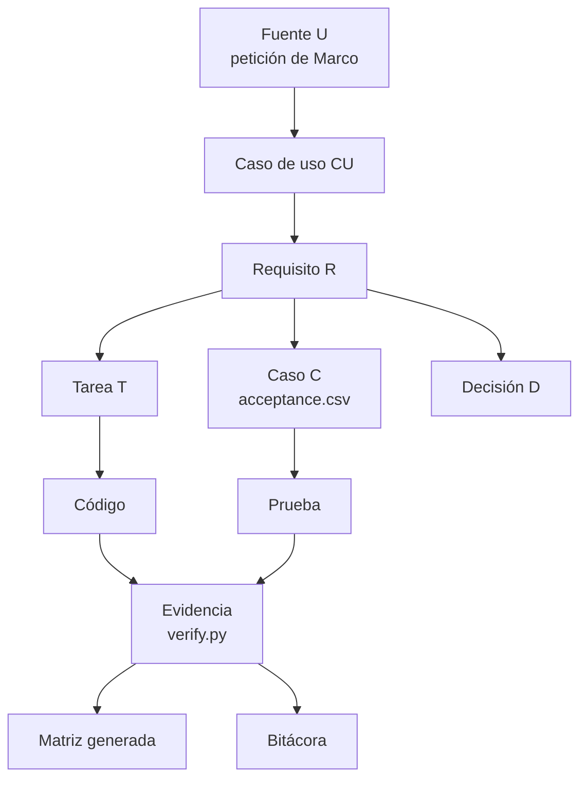

# 4 Método de ingeniería y SDD

[Índice del libro](README.md) · Código descrito: `a16a4e67b4257c2cb13054efd3ffa20acc2dd3be` (PR #9). Este capítulo explica qué aporta cada registro y cómo se encadenan; la fuente del método es el libro privado de Marco (base 1.0, extensión portable 1.1, adopción 2026-10-03), del que el repositorio no copia texto ([sdd-adoption.md](../sdd-adoption.md), *Source and interpretation*).

## 4.1 La cadena: de la necesidad a la evidencia

**Equivalente en texto.** Una petición de Marco se registra como fuente U; de ella salen casos de uso CU y requisitos R escritos con *shall*; cada requisito tiene tareas T y casos de aceptación C; cada caso nombra la prueba que lo ejecuta (`test_id`) y `scripts/verify.py` escribe el resultado observado, el estado, la evidencia, el entorno y la huella de fuentes en `acceptance.csv` y `evidence/latest.json`; las decisiones D explican por qué se construyó así; la matriz de requisitos se genera de los registros y una clasificación revisada; la bitácora cierra cada cambio con lo hecho y lo pendiente (constitución, reglas 2, 4 y 11).

Qué aporta cada pieza, en una frase:

| Registro | Aporta | Lo que no es |
|---|---|---|
| `spec.md` | El acuerdo: necesidad, actores, exclusiones, U/CU/R con enmiendas fechadas | No es diseño ni evidencia |
| `plan.md` | Componentes, contratos, herramientas y alternativas por incremento | No es compromiso de calendario |
| `tasks.md` | Qué tarea implementa qué requisito y en qué estado | No prueba nada por sí misma |
| `acceptance.csv` | Un caso por comportamiento esperado, con lo observado y el estado por revisión | No es aceptación del dueño (CU07: "A commit is not owner acceptance") |
| `tests/` | La comprobación ejecutable, positiva y negativa | Pasar las pruebas no autoriza publicar (R56e) |
| `evidence/` | Lo observado por la máquina, con huellas de fuentes y registros | No se regenera para ocultar una discrepancia (D40) |
| `decisions.md` | Problema, decisión, motivo, estado y quién decide | No sustituye la autoridad del dueño: "Silence never changes their authority" |
| `notebook.md` | Continuidad: qué se hizo, con qué revisión, qué queda | No es informe de marketing |

## 4.2 Reglas que gobiernan cada cambio

De la [constitución](../constitution.md) (versión 0.2, 2026-10-03), las que más explican el código:

- Regla 2: definir caso de uso, fuente, tarea y comprobación esperada **antes** del siguiente cambio de comportamiento. En las rondas de revisión de U21 esto se ve en el orden de los commits: registros, fix, evidencia ([cap. 6](06-validacion.md#64-las-rondas-de-revisión-independiente)).
- Regla 4: registrar PASS/FAIL/NO_PROBADO y la versión probada; publicación y aceptación tienen registros separados.
- Regla 6: preservar la ejecución determinista sin red; por eso `python run.py tour` y `evaluate` corren sin clave (`model_calls: 0`, `src/lab/cli.py:7-14`).
- Regla 7: la autorización de efectos reales vive en el ejecutor; "A role name, prompt or skill is not access control". Es la razón de que un agente sea texto y de que `agent_store.resolve` añada el sufijo de "sin herramientas" (`src/lab/agent_store.py:72`).
- Regla 9: conservar fallos, historia y borradores; no reescribir historia para fingir cumplimiento SDD previo. Por eso el primer entregable, que precedió a su especificación, sigue registrado como desviación ([sdd-adoption.md](../sdd-adoption.md)).

## 4.3 Estados y vocabulario

| Término | Definición registrada | Fuente |
|---|---|---|
| PASS / FAIL / NO_PROBADO | Enumeración del corredor por prueba; `verify.py` registra NO_PROBADO cuando el corredor omite el caso | R49e; `scripts/verify.py:54` |
| BLOQUEADO, NO_APLICA | Estados de caso e insignia; NO_APLICA queda fuera del conteo y debe decir por qué | D33, R36a |
| Insignia por requisito | FAIL > BLOQUEADO > PASS (todos los casos aplicables con evidencia) > PARCIAL "n de m" > PENDIENTE | D33; `web/evidence-rules.js:5-20` |
| Clases de caso | `behavior` ejecuta código; `structure` inspecciona texto o archivos; `document` valida registros; `manual` es una persona o una corrida grabada; polaridad positiva, negativa o límite. Un caso estructural nunca cuenta como el positivo de comportamiento | D42; `case-kinds.json` |
| Override | Clasificación por debajo del piso derivado de las pruebas, solo con motivo, autoridad y fecha, impreso en la matriz | D44, R51d |
| VERIFICADO / PARCIAL / NO_PROBADO / FUTURO | Estados de control de seguridad derivados de los casos: ambas polaridades aprobadas; algunos; ninguno; sin caso. FUTURO nunca cuenta | D49, R57b; `scripts/security_catalog.py` |
| Huella de fuentes / de registros | `source_id` sobre src, tests, scripts, data, web, agents, workflows y run.py; `record_id` sobre specs, project-status e id-registry (acceptance.csv sin la columna de entorno); evidence/ en ninguna | D38, R42a; `scripts/check_evidence.py:29-32` |
| Candidato / revisión aceptada / publicada | Una rama no publicada; la revisión que nombra `acceptance.revision`, acotada a su árbol; la que sirve Pages según `deployment` | R47a, D41, D43 |

## 4.4 Cómo se verifica un cambio (lo que hace `scripts/verify.py`)

1. Descubre y ejecuta `tests/` con `unittest`; registra cada prueba.
2. Valida los fixtures (`validate_data.py`), pasa la guarda de publicación sobre el árbol, el `sdd_check` (estructura de spec, plan, tasks, casos, registros e IDs), la comprobación de seguridad (`security_check.py`: reglas estáticas, inventario de biblioteca estándar, pins y permisos de los workflows, secretos) y la evaluación de los siete escenarios.
3. Reescribe cuatro archivos generados: `evidence/latest.json`, `evidence/sdd-check.json`, `specs/001-support-demo/acceptance.csv` y `docs/requirements-matrix.md` (`scripts/verify.py:64-144`).
4. `scripts/check_evidence.py` comprueba que la evidencia comprometida describe exactamente estas fuentes y registros (`--save` y `--against` en CI). Tras editar un registro, la primera corrida falla por construcción hasta que registros y evidencia se describen mutuamente (C233, C248); por eso cada entrega muestra una corrida de arranque y dos idénticas.

Inferido (no registrado): el requisito de "dos corridas idénticas" funciona como prueba de reproducibilidad barata; el registro lo formula como regla (R53b, D32) sin explicar ese motivo.

## 4.5 Por qué un libro de ingeniería

Lo registrado: U01 pidió una "engineering-book structure"; U02, una "faithful SDD application"; U03, "complete the method"; D09 optó por "reconcile existing work rather than regenerate the project". La necesidad declarada es que un reclutador o cliente pueda inspeccionar cómo Marco define, elige herramientas, organiza y verifica. Este libro (D58) añade la ruta de lectura que faltaba entre los registros por incremento y el código, sin crear un segundo registro ([cap. 5](05-decisiones.md#56-la-decisión-nueva-de-esta-entrega)).

## Summary in English

Every behavior change follows one chain: an owner source (U) gives use cases (CU) and "shall" requirements (R); each requirement has tasks (T), acceptance cases (C) with the test that runs them, and decisions (D) with the recorded reason; `scripts/verify.py` runs the suite, the data, publication, SDD and security checks and the scenario evaluation, then rewrites the four generated files; `check_evidence.py` ties committed evidence to the exact sources and records through two fingerprints, so a records edit forces a fresh run. Statuses, case kinds, overrides, control states and fingerprints are defined by the records cited above. The constitution's rules 2, 4, 6, 7 and 9 explain the order "records, fix, evidence", the offline deterministic tour, why an agent is text only and why historical deviations stay recorded. The book exists to give the records a readable route, not to replace them.
